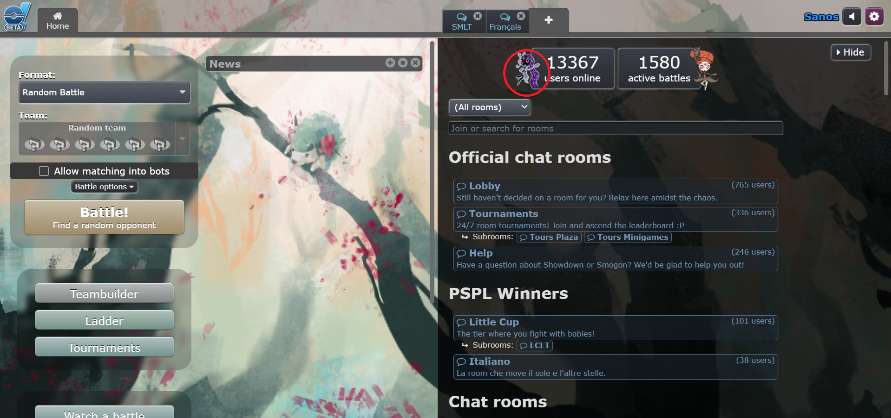
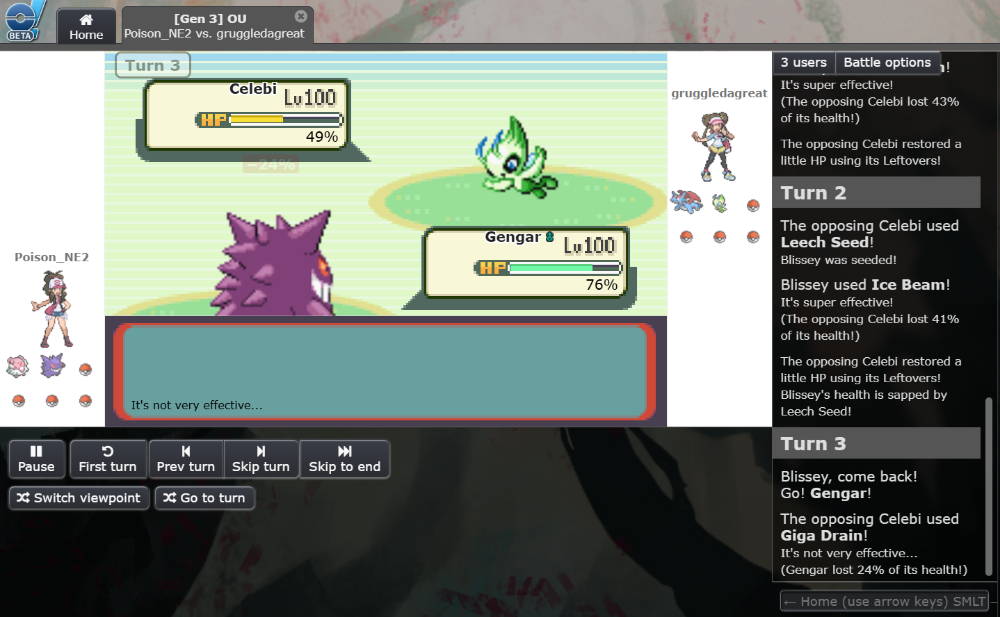

# Retro Showdown 

Retro Showdown is a purely visual web extension for [pokemon showdown](https://play.pokemonshowdown.com). It modifies the site's UI and animations in order to reproduce as closely as possible the in-game battles from older pokemon games. For now, it only includes animations from the generation 3 pokemon games.

## How to install
Since the extension is not yet finished, it has to be installed localy from your computer. **This also means that the extension has not been verified. Proceed at you own risks.**

In order to install the extension localy, 
* Download this repository as a zip file. This can be done under the `< > Code` dropdown.
* Extract the zip file and remember where you place the resulting folder.
* For chromium browsers (Chrome, Brave, ...):
    * Open the `extensions` page (can be accessed by typing `chrome://extensions` in your hotbar)
    * In the top right corner, turn on `Developer mode`
    * Click the `Load unpacketed` button, and select the folder that you just extracted. **Make sure that the folder you select contains the file `manifest.json` as well as all the files listed in the [project directory](#project-directory).**
* For Firefox : 
    * Type this in your hotbar : `about:debugging#/runtime/this-firefox`.
    * Click on the `Load Temporary Add-on` button.
    * Select any file that is in the same folder as `manifest.json` after making sure that this folder contains all the files listed in the [project directory](#project-directory).
    * This will install the extension untill you close Firefox. Do this again every time you want to use it again!
* For other browsers, I have not tried myself. I think that it should woks, so just look up how to install extensions from your computer and you should be good. Don't hesitate to contact me if you need help!

You will know if the extension is successfully installed if the meloetta on the main menu looks *evil*. 

Here is what a battle should look like : 

## State of the project
The extension is in eraly release. Its main feature (the battle animations) is mostly complete and bug free but it is far from finished. You can see all the planned features in the [to do file](todo.txt).  
If you notice any bugs, or any laggy animation, please [tell me about it](#contact)! You can find all the reported bugs and laggy animations in the [to do file](todo.txt).

### Current state of the extension

As of now, enabling the extension will automatically turn all battles into "gen 3" battles, meaning the pokemon will have their sprite from gen 3 (or their oldest sprite if they are from a later gen), and this for every format.  
It also overwrites the PS animations with those that I have written. You can find the full list of animations in the [to do file](todo.txt).

### Current problems
Here I list the main issues with the project that i want to have fixed before exiting the pre-release state.

* **Only standard single battles are supported.** While the animations should work in every format (not tested outside of single battles), I have not yet implemeted any code to handle more than one pokemon on each side, leading for example to the healtbars overlapping each others. Other different formats such as blitz also cause some visual glitches.
* **No customisation.** Right now, every battle without exception gets affected by the extension. I want to add a way for users to select when the animations should be changed. I also would like to implement a speed slider, because I know that those animations are very slow.
* **Bugs with showdown specific UI.** I have not yet found a way to properely implement all the UI that showdown adds as QOL (visible hasards, turn counter, display of currenltly active field conditions, ...). For now the in-game UI conflicts with the PS UI, making some effects invisible. Team preview is also quite ugly and would need to be remade.
* Some precise positions change out at different resolutions, most noticably the hp bars (see above picture).

#### Workarounds
You can change the speed of the animations by modifying the `frame` variable : click F12 to open the inspect menu, then go to the `Console` tab. Here, do not get intimidated by the huge amont of text and just click on the empty space next to the `>` at the bottom of the window and type `frame /= 2` if you want to multiply the speed by 2, or `frame *= 2` if you want to divide the speed by 2. This will go away on page refresh.  
If you want to access the information that is hidden behind the new UI, just hover over the turn counter and they will show up.  
If you want to disable the extension for a specific battle, you will have to go to your browser's extension page and disable it, then refresh showdown (if you are challenging someone, wait before you are in the battle before refreshing).

### Planned improvements
* I plan on animating every attack in the top 100 of usage across all smogon tiers **that are present in gen 3**. Since I am not an artist, I only recreate animations from the games. The list of planned attacks is available in the [to do file](todo.txt).
* I would like to implement the text effects and police of gen 3.
* Depending of technical criterias, I may add all the sound effects from the game.
* Fun stuff, like begining of battle animations (with a toggle for an "important battle" with a special animation???) and pokemon entry animations.

* In the long run, I would like to do the same for gens 4 and 5, and maybe even 1 and 2. How long this will take is to be seen. (gen 5 is next tho)

## Project directory
In this section, I list all the files normaly present in this directory and explain their functions.

├── [**manifest.json**](manifest.json) : This is the file that defines the properites of the extension. It lists what files are accessible by it, what files to load and on which websites.  
├── [**init.js**](init.js) : This is the file that gets loaded by the extension. Its job is simply to load in the three following scripts into the page, as well as the custom css.  

└── **scripts**  
&emsp;&emsp;├── [**test2.js**](scripts/test2.js) : This file handles everything that is not directly tied with animations, such as the battle dimensions, the statbar, etc...  
&emsp;&emsp;├── [**animations.js**](scripts/animations.js) : This file contains various functions relating to animations, as well as non-attacks animations such as switching.  
&emsp;&emsp;├── [**move-anim.js**](scripts/move-anims) : This file contains all the remade battle animations, as well as the import of visual effects.  

├── [**custom_style.css**](custom_style.css) : This file contains the custom css used by the extension.  
├── [**image_sizes.json**](image_sizes.json) : This file is a json that, for every relevant sprite used by showdown, stores its dimensions. This is necessary because wheras each pokemon sprite has a different size, all pokemon sprites are stored with the same image dimensions (96x96 px), with the sprites being framed by different amount of transparent pixels. Having access to the proportions of the sprites allows more fine placements. This file is loaded in [animations.js](scripts/animations.js)  

└── [**fx**](fx/) : this folder contains all the visuals for the various effects added by the extension. The folder itself contains visuals not directly tied to attacks, such as battle backgrounds and the healthbars sprites.  
&emsp;&emsp;├── **---.png/.gif**  
&emsp;&emsp;└── [**moves**](fx/moves/) : this folder contains visuals used in attack effects. All sprites here are stored in BattleEffects.  
&emsp;&emsp;&emsp;&emsp;├──  **---.png/.gif**  

## Credits
All the code was written and tested by me.  
Usage of AI : minimal, mostly as an advanced documentation as it is my first time working with advanced html. All significant bits of code puerly written by AI are indicated.

Huge thanks to the following users who extracted and assembled many in-game effects :
* Neslug for sharing the move effects on [this page](https://www.spriters-resource.com/game_boy_advance/pokemonemerald/asset/28882/) (visited on 22/09/2026)
* LDEJRuff for sharing the stats changing effects on [this page](https://www.spriters-resource.com/game_boy_advance/pokemonemerald/asset/19782/) (visited on 22/09/2026)
* SmartyPanda for sharing the suby & sapphire battle backgrounds on [this page](https://www.spriters-resource.com/game_boy_advance/pokemonrubysapphire/asset/8303/) (visited on 22/09/2026)
* Aquatics64 for sharing the battle menus from ruby & sapphire on [this page](https://www.spriters-resource.com/game_boy_advance/pokemonemerald/asset/26964/) (visited on 23/09/2026)
* Previous for sharing the menus from emerald on [this page](https://www.spriters-resource.com/game_boy_advance/pokemonemerald/asset/26964/) (visited on 25/09/2026)
* redblueyellow for sharing the hp bars from fire red & leaf green on [this page](https://www.spriters-resource.com/game_boy_advance/pokemonfireredleafgreen/asset/33690/) (visited on 28/09/2026)
* wormintheworks for sharing the pokeball animations on [this page](https://www.spriters-resource.com/game_boy_advance/pokemonemerald/asset/20106/) (visited on 28/09/2026)

Huge thanks also to the developpers of [HexManiacAdvance](https://github.com/haven1433/HexManiacAdvance/tree/c8de1e8acf753522af7feed810d6324ce52474a3). This program made it much easier to find certain specific sprites, and is so easy to use that it could have been used for every sprite extraction had i known about it earlier.

Another huge thank to the contributors of https://pokepedia.fr and of https://bulbapedia.bulbagarden.net for sharing very high quality gifs of every attack. This made it soooo easy to recreate animations frame by frame, I dont think this project would have been possible without their contributions.  
For spliting the gifs into frames, I used https://ezgif.com/split which not only worked but also provided frame counters to make recreating the animations much easier.

Lastly, I would like to thank the [pret group](https://pret.github.io/) for their work on the [decompilation of pokemon emerald](https://github.com/pret/pokeemerald) which includes an explicit c script for every attack. Due to my lack of familiarity with C I ended up rarely using these scripts but they where very usefull for the most complex animations.  
~~Also I imagine that with a bit of work one could ask an AI to transcipt these animation script into PS animations...~~

## Copyright
IDK WHAT TO PUT HERE
Dont steal. this code was made by me.
All animations and sprites where created by Nintendo.

## Contact
Discord: sanos3784  
Smogon: [Sanos](https://www.smogon.com/forums/members/sanos.598305/)  

Feel free to contact me if you spot any bug, or if you have any questions!